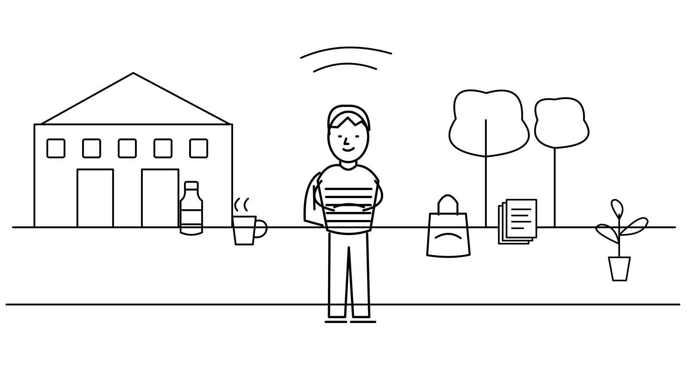

# One Day, Less Waste

A gesture-controlled comic game about everyday waste prevention.

Play as a university student through **16 scenes in one day**. Point with an open hand, pinch to choose, and release before making another choice. What you pack in the morning changes the options available later. At the end of the day, follow the actual items you acquired, kept, handed over or discarded.



**English interface · Four chapters · Gesture-only game controls · No answer countdown**

## Play

1. Open the game on **HTTPS or localhost** in a current desktop Chrome or Edge browser.
2. Allow camera access when the browser asks.
3. Hold an open hand where the camera can see it. Move your index fingertip to point at an option.
4. Pinch your thumb and index finger together to select it.
5. Open your fingers again before selecting another option.

The opening practice lets you rehearse pointing, pinching and releasing. Hovering only highlights a target; it never selects automatically. Choices lead directly into an aftermath and fade-to-black transition. There is no extra next-question screen.

Pause, help, backpack, summary pages, replay and report export use the same gesture controls. The camera permission dialog and the browser's download interface belong to the browser.

## Run locally in VS Code

Open the extracted folder that contains **package.json** in VS Code. Use a recent Node.js release supported by the dependencies: Node.js 22.22.2+, 24.15.0+, or 26+.

In the terminal, install the locked dependencies:

```powershell
npm ci
```

Then start the development server:

```powershell
npm run dev
```

Open **http://127.0.0.1:5174/** and allow the camera. Keep the terminal running. Press **Ctrl+C** to stop it. Subsequent starts only need `npm run dev` unless dependencies have changed.

### Run the included production build

A release ZIP also includes a ready-built `dist` folder. With Python installed, run:

```powershell
.\Start.cmd
```

Alternatively:

```powershell
python -m http.server 5174 --bind 127.0.0.1 --directory dist
```

This route does not require `npm ci`. Do not open `index.html` directly through `file://`.

## Build and deploy to Netlify Drop

From the project folder:

```powershell
npm run build
```

After a successful build, drag the **entire dist folder** into Netlify Drop.

- `index.html` is already inside `dist`; do not upload it separately.
- Keep `art/`, `models/`, `mediapipe/`, `assets/` and `_headers` alongside it.
- Upload `dist`, not the parent project folder or `node_modules`.
- After updating a site, hard-refresh it with **Ctrl+Shift+R** and allow camera access for that site's address.

The hand tracker needs `mediapipe/hand-tracking-worker.js`, the accompanying WASM files and `models/hand_landmarker.task`. Uploading only the HTML cannot provide these resources.

To preview your own production build locally:

```powershell
npm run preview
```

The default preview address is **http://127.0.0.1:4174/**.

## What the game includes

- Sixteen fixed scenes across morning, daytime, evening and night, with two or three feasible choices per scene.
- Morning packing that affects coffee, drinking water, lunch and shopping options.
- A consistent black-and-white campus comic, large readable controls and automatic scene transitions.
- Practice, backpack inspection, pause/resume, local saved days and replay.
- A unique-item ledger: repeated appearances of the same bag or sheet of paper do not create duplicate items.
- Separate reporting for new single-use items, non-food discarded items, food discarded in servings, and items continuing in use.
- Actual-choice reflections and an optional comparison with a previous replay.
- An optional research flow with consent, participant codes, alternate knowledge-check sets and four experience ratings.

Recycling remains a discarded-item destination. Saved food is not reported as already eaten, and edible inventory is not counted as food waste. The game does not estimate kilograms, carbon savings, trees saved or a combined environmental score.

## Gesture performance in version 1.0.4

Hand inference runs in a **dedicated classic Web Worker**, with GPU initialization and a CPU fallback inside that worker. The interface thread handles the comic, cursor and choices.

The pipeline allows **one frame in flight**. If inference is busy, it skips intervening camera frames and captures a current frame when ready, rather than queueing old images. Frames are resized to at most 640 pixels wide before transfer; each transferred bitmap is closed after processing.

Other changes include:

- Camera-frame callbacks where supported, with an animation-frame fallback.
- A target inference cap of 30 frames per second; this is a cap, not a measured or guaranteed frame rate.
- No new inference submissions while the page is hidden.
- Generation checks that discard results from a stopped or previous tracking run.
- A separate cursor component using compositor transforms, so pointer movement does not rerender the whole comic screen.
- One shared topmost-button hit test per tracking frame.
- A shorter pointer smoothing constant (35 ms) and pinch stability interval (70 ms), while preserving release-to-rearm and one-choice-per-pinch safeguards.

The worker is compiled locally before `dev` and `build`, so both routes use the same worker format and matching MediaPipe resources. Restart the development server after editing worker implementation files.

These changes reduce avoidable blocking and queued-frame latency. Actual responsiveness still depends on the camera, browser, lighting and hardware. Real-hand accuracy, fatigue and perceived smoothness require testing on the intended device. Different application versions should be identified separately in research analysis.

## Data and privacy

Camera images are processed in the current browser, including the local background worker. The application does not save video, photos, hand landmarks or real names, and does not send frames to an online inference service.

Sessions stay in this browser under `ecosort:comic-day:v1`. There is no account system, database or cloud synchronization. Different browsers, devices and site origins have separate storage. Export records before clearing site data. A storage failure is shown as a warning; the current in-memory record can still be exported.

Research records include the participant code, actual choices, available options, timing, interruptions, asset status and collected responses. Free play and research sessions remain distinguishable. Formal study consent, identity-code mapping and interview/observation records are managed separately by the researcher.

## Reports and research

The in-game export creates a ZIP containing the raw session JSON, choices/items/summary CSV files, offline HTML and Markdown reports, SVG charts, a standard-library Python analysis script and field explanations.

Partial sessions can be exported and remain marked as partial. Missing timing is not silently converted to zero. Replay comparisons are only generated when a previous session exists. The export does not invent interview quotes, research themes, statistical significance or long-term behaviour changes.

See [the study guide](materials/STUDY_GUIDE.md) and [implementation notes](docs/IMPLEMENTATION.md). Collection categories are illustrative prototype rules, not verified ANU or ACT disposal guidance.

## Development and verification

| Command | Purpose |
| --- | --- |
| `npm ci` | Install the exact dependency lockfile |
| `npm run dev` | Prepare assets and start Vite on port 5174 |
| `npm test` | Run the automated checks |
| `npm run build` | Check TypeScript, compile the worker and build deployable files |
| `npm run preview` | Serve the production build on port 4174 |
| `npm run prepare:assets` | Synchronize WASM files, compile the worker and check artwork/model presence |
| `npm run art` | Regenerate the code-drawn SVG scene illustrations |

The stack is Vue 3, TypeScript, Pinia, Vite 6.4.5 and MediaPipe Tasks Vision 0.10.35. The pinned Vite version is compatible with the included Vue plugin.

Automated coverage includes all sixteen scenes, conditional choices, complete low/high-waste paths, 400 deterministic mixed paths, idempotent submissions, unique-item accounting, pause timing, interrupted saves, gesture locks, actual task-bundle loading, worker backpressure, stale-frame rejection, bitmap cleanup, shared hit testing, extractable exports and agreement with Python replay.

Automated checks do not replace a real-camera user trial.

## Project structure

| Path | Responsibility |
| --- | --- |
| `src/data/story/` | Scene text, choices, initial items and study questions |
| `src/domain/story/` | Deterministic story transitions, item ledger, timing and analysis |
| `src/services/handTracking.worker.ts` | Background MediaPipe initialization and inference |
| `src/services/handTrackingService.ts` | Camera-frame scheduling and worker lifecycle |
| `src/domain/gestureInterpreter.ts` | Pinch edges, tracking recovery and pointer smoothing |
| `src/components/` | Gesture controls, isolated cursor and comic stage |
| `src/stores/` | Device, navigation and story state |
| `public/art/` | Cover, sixteen scene SVGs and art metadata |
| `public/models/` | Hand task bundle |
| `public/mediapipe/` | Generated worker and matching WASM resources |
| `materials/` | Study guide and offline analysis |
| `tests/` | Automated domain and interaction checks |
| `dist/` | Generated deployment folder |

## Troubleshooting

| Symptom | What to check |
| --- | --- |
| `vite is not recognized` | Run `npm ci` in the folder containing `package.json`, then `npm run dev`. |
| Dependency conflict involving Vite | Use this release's `package.json` and lockfile together. Do not mix them with an older archive or use `--force` to hide the conflict. |
| Camera denied or unavailable | Allow access in the browser's site settings, close other apps using the camera, and reload. |
| Background tracking unsupported | Use a current desktop Chrome or Edge browser with Worker, OffscreenCanvas and ImageBitmap support. |
| Missing model, worker or WASM | Read the named resource error and upload the complete `dist` folder. For local development, rerun `npm run prepare:assets`. |
| Missing illustration | Confirm that `dist/art` was uploaded. Text fallback is marked as degraded in the session. |
| Pointer is unavailable | Show the whole hand in even lighting, open the fingers and keep a clear separation between thumb and index finger. |
| Pointer feels slow | Test the production build, close competing camera/heavy applications, and verify that you opened the updated deployment. The target rate is hardware-dependent. |
| A choice does not fire after a transition | Release the pinch first, then pinch again over the target. |
| A new browser shows no saved days | Storage is local to the device, browser and site origin. |

## License and acknowledgements

A project-wide reuse license has not been selected for the original application in this release. This README does not itself grant reuse or commercial permissions. Third-party software and model files retain their applicable original terms.

MediaPipe provides hand landmark detection; Vue, Pinia and Vite provide the application framework and tooling. The campus scenario, illustrations and item-accounting rules form a coursework prototype. No participant data or study findings are bundled.

The background-inference design follows the [MediaPipe web guide](https://developers.google.com/edge/mediapipe/solutions/vision/hand_landmarker/web_js), which explains that synchronous detection can block the interface and recommends Web Workers.
