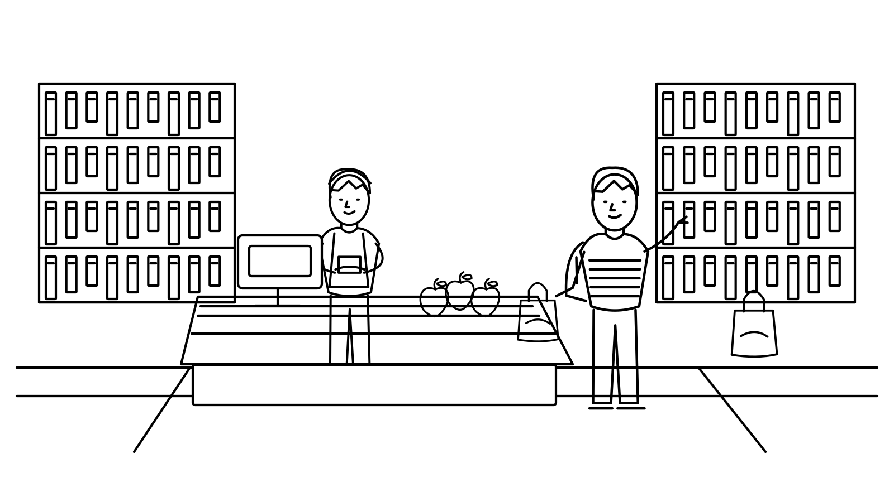

# SECOND NATURE

*Small choices. An everyday story.*

**[Play Online](https://enchanting-paletas-d0187b.netlify.app/)**


## The Game

Spend a day as a university student, making choices about food, packaging, reusable items and everyday waste across **16 comic scenes**.

What you pack in the morning changes your options later. At the end of the day, see what you acquired, kept, shared or discarded. There is no answer countdown.

## How to Play

1. Open **Play Online** in a current desktop Chrome or Edge browser.
2. Allow camera access and complete the short practice.
3. **Point** at an option with an open hand.
4. **Pinch** your thumb and index finger to choose.
5. **Release**, then make a fresh pinch for your next choice.

Gameplay, pause, backpack, replay and report export use hand gestures. Camera images are processed locally and are not recorded.

## Comic Preview



*A checkout scene from the game's campus-life story.*

## About the Project

SECOND NATURE is an HCI coursework prototype exploring gesture interaction and waste prevention through everyday decisions.

Built with **Vue 3, TypeScript, Pinia, Vite and MediaPipe**, it combines comic storytelling, connected choices and an item ledger. Results distinguish new single-use items, discarded materials, food waste and items kept in use.

## Run Locally

From the repository root:

```bash
cd OneDayLessWaste
npm ci
npm run dev
```

Open **http://127.0.0.1:5174/** and allow the camera.
